<p align="center">
  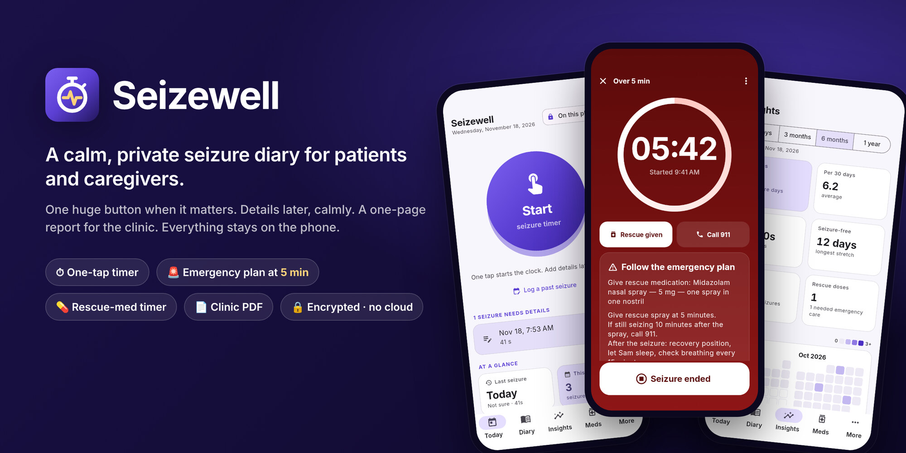
</p>

<p align="center">
  <a href="https://github.com/lobojoel2003/Seizewell/actions/workflows/ci.yml"></a>
  <a href="https://github.com/lobojoel2003/Seizewell/releases/latest"></a>
  <a href="LICENSE"></a>
  
  
  
</p>

**Seizewell** is a free, open-source seizure diary for people with epilepsy and
the people who look after them. One tap times a seizure; at five minutes the
screen turns red and shows the family's own emergency plan; details are filled
in later, calmly; and a one-page report goes to the clinic.
**Everything stays on the phone**, encrypted.

> [!IMPORTANT]
> Seizewell is a diary, not a medical device. It does not detect, diagnose or
> treat seizures. In an emergency, call your local emergency number.

## Contents

- [Why Seizewell](#why-seizewell)
- [Features](#features)
- [The clinic report](#the-clinic-report)
- [Privacy and security](#privacy-and-security)
- [Install](#install)
- [Build from source](#build-from-source)
- [How it works](#how-it-works)
- [Testing, CI/CD and releases](#testing-cicd-and-releases)
- [Roadmap](#roadmap)
- [Contributing](#contributing) · [License](#license)

## Why Seizewell

Neurologists adjust epilepsy treatment from what the patient reports, and
memory of seizures is poor. A diary fixes that — but the popular apps keep
this very sensitive data on company servers.

- About **2.9 million U.S. adults and 456,000 children** have active epilepsy
  ([CDC](https://www.cdc.gov/epilepsy/data-research/facts-stats/index.html)).
- Among adults taking epilepsy medication, **only 44%** reported their
  seizures were controlled
  ([CDC MMWR](https://www.cdc.gov/mmwr/volumes/67/wr/mm6715a1.htm)).
- Patient groups tell families to keep a diary because it helps doctors
  "see how effective your current treatment is" and find triggers
  ([LGS Foundation](https://www.lgsfoundation.org/keeping-a-seizure-diary/)).

The diaries people use today —
[Seizure Tracker](https://apps.apple.com/us/app/id410716391),
[EpiDiary](https://apps.apple.com/us/app/epidiary/id362460642),
[Helpilepsy](https://apps.apple.com/us/app/helpilepsy/id1276141618) and the
[Epilepsy Ireland Diary](https://apps.apple.com/app/id1074819139) — are all
closed source. A GitHub search for "seizure diary" returns 15 repositories,
the largest a research simulator with 2 stars, and nothing open is on
F-Droid. Seizewell is the open, private alternative.

|  | Seizewell |
| --- | --- |
| Where the diary lives | Only on your phone, SQLCipher-encrypted |
| Account | None |
| Network access | None — the Android app has no internet permission |
| Source code | Open (GPL-3.0) |
| For the clinic | One-page PDF, CSV and FHIR R4 |
| Price, ads, tracking | Free, none, none |

## Features

### When it matters: one tap

<table>
  <tr>
    <td align="center" width="25%">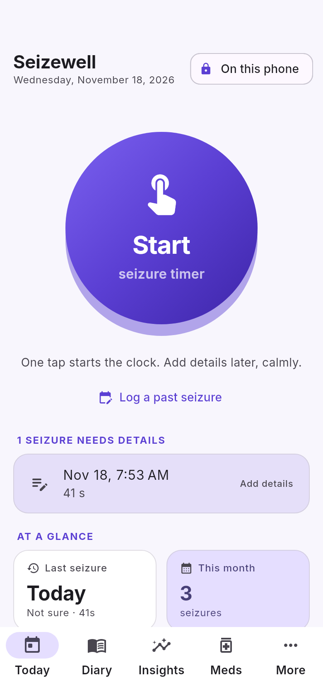<br><sub><b>One huge button.</b> Also on the home-screen widget, the Quick Settings tile and app shortcuts.</sub></td>
    <td align="center" width="25%">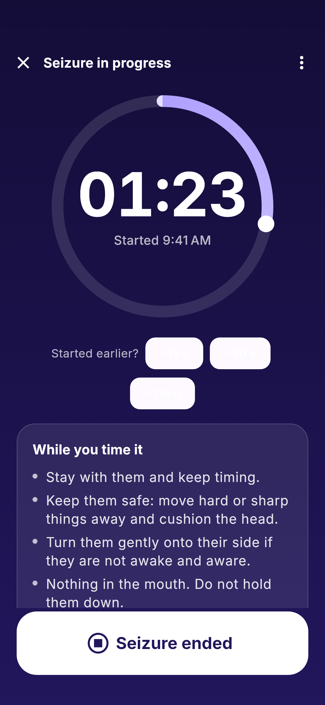<br><sub><b>A clear timer</b> with first aid (Stay, Safe, Side) and "started earlier?" fixes.</sub></td>
    <td align="center" width="25%">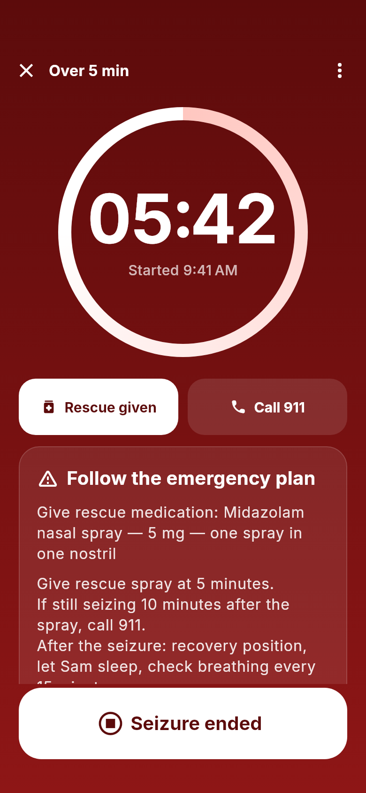<br><sub><b>Red at 5 minutes</b> with the family's own plan, rescue dose and one-tap calls.</sub></td>
    <td align="center" width="25%">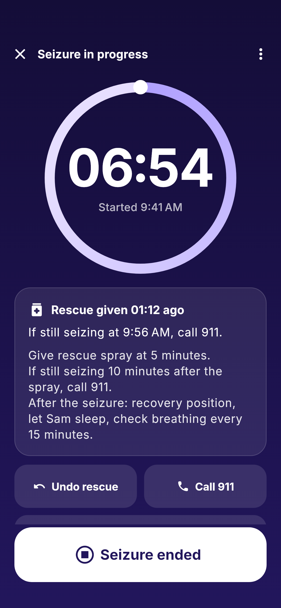<br><sub><b>Rescue-medication timer</b> counts down to "call for help".</sub></td>
  </tr>
</table>

- **Start from anywhere:** the Today screen, the app's lock screen (the Start
  button works without unlocking), an Android **home-screen widget**, an
  Android **Quick Settings tile** that opens just the timer **from the phone's
  lock screen**, and long-press **app shortcuts** on Android and iOS.
- **Escalation you can see and feel:** the ring fills toward your plan's
  threshold (5 minutes by default), then the screen turns red, the phone
  vibrates and the emergency plan appears.
- **Keeps working in the background:** a live stopwatch notification (an
  Android 16 Live Update where supported) and alerts at the thresholds, even
  while you are on the phone to emergency services. The screen stays on
  while timing.
- **Forgiving:** double taps never start two timers, "Started earlier? −15 s"
  backdates the start, "Not over — resume the timer" undoes an early stop,
  and "started by mistake" discards it.

### Afterwards: details, calmly

<table>
  <tr>
    <td align="center" width="25%">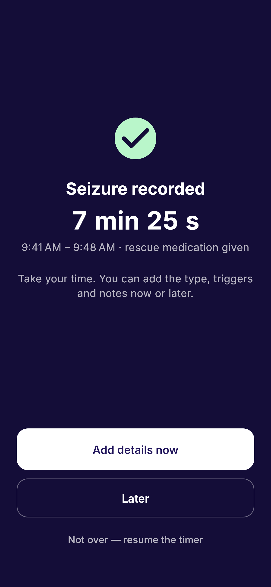<br><sub><b>Saved instantly.</b> Add details now or later.</sub></td>
    <td align="center" width="25%">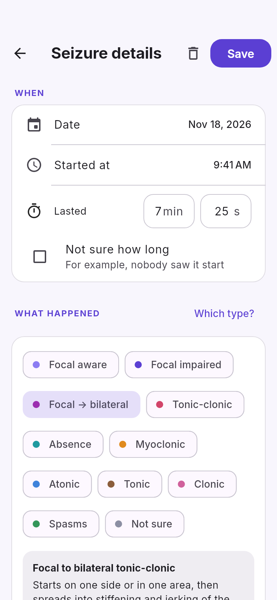<br><sub><b>Seizure types in plain language</b>, based on ILAE 2017.</sub></td>
    <td align="center" width="25%">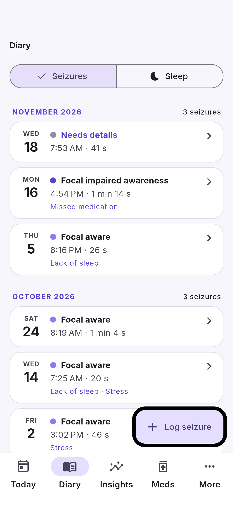<br><sub><b>Diary</b> of seizures and sleep, with a "needs details" nudge.</sub></td>
    <td align="center" width="25%">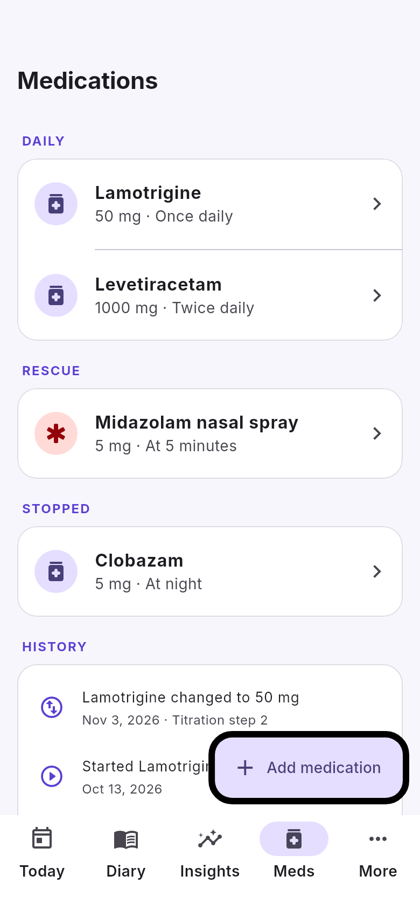<br><sub><b>Medications</b> with start, dose-change and stop history.</sub></td>
  </tr>
</table>

- Type (with a "Which type?" guide), triggers (12 built-in plus your own),
  aura, during sleep, injury, ambulance/ER, rescue medication and notes.
- Sleep log (hours and quality) — short sleep is one of the most common
  triggers.
- Medication changes are recorded automatically when a dose is edited, so
  the report can show what changed when.

### Insights

<table>
  <tr>
    <td align="center" width="33%">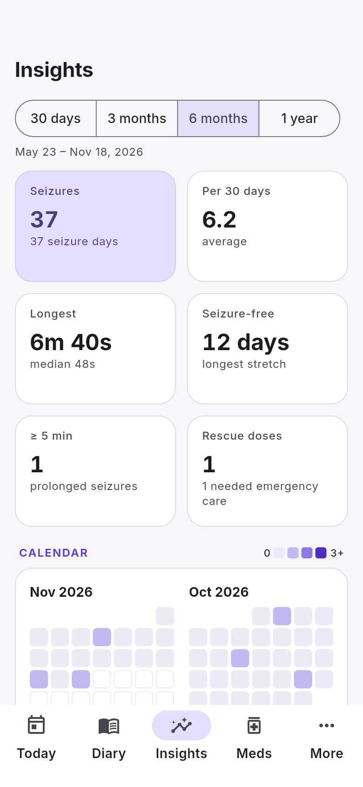<br><sub>Totals, per-30-day rate, longest, prolonged (≥ 5 min), rescue doses, seizure-free stretch.</sub></td>
    <td align="center" width="33%">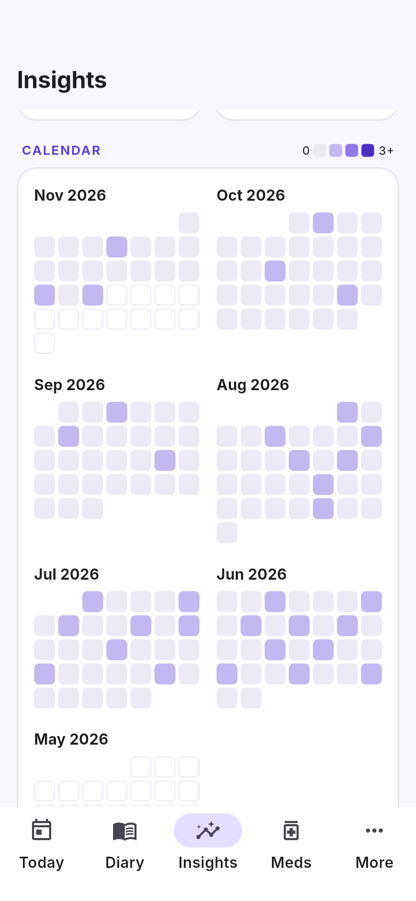<br><sub>Calendar heat map.</sub></td>
    <td align="center" width="33%">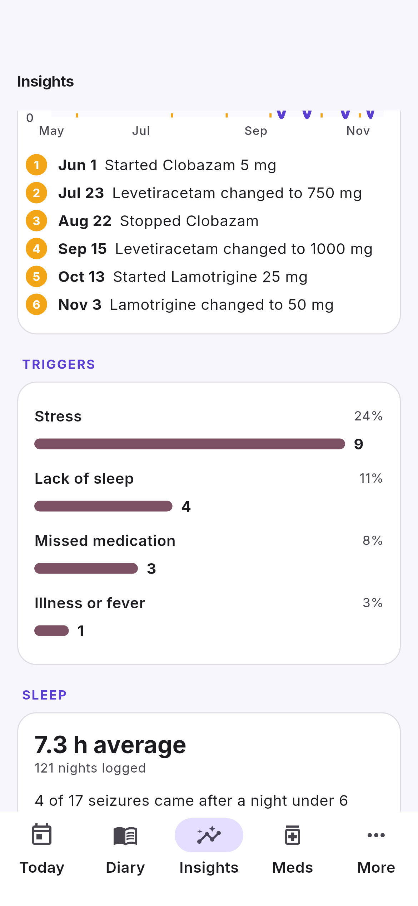<br><sub>Counts by type and a trend with medication changes marked.</sub></td>
  </tr>
</table>

### And also

<table>
  <tr>
    <td align="center" width="25%">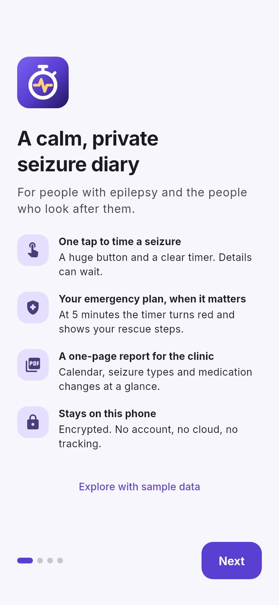<br><sub>Two-minute setup, or explore with sample data.</sub></td>
    <td align="center" width="25%">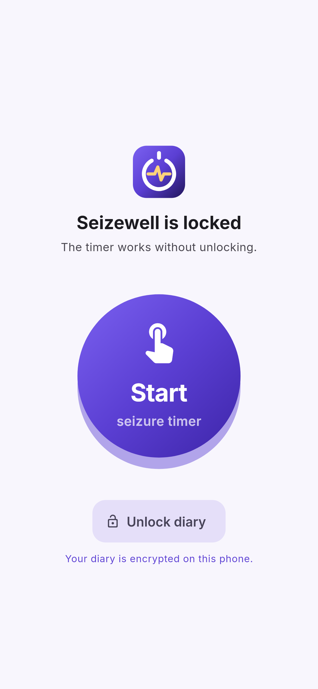<br><sub>Optional app lock — the Start button still works.</sub></td>
    <td align="center" width="25%">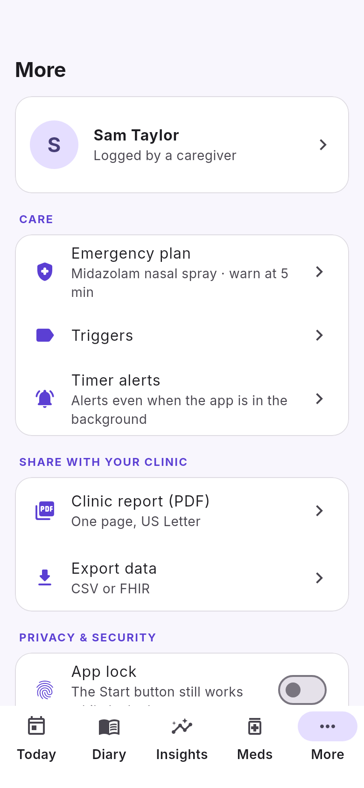<br><sub>Emergency plan, exports, backups, theme.</sub></td>
    <td align="center" width="25%">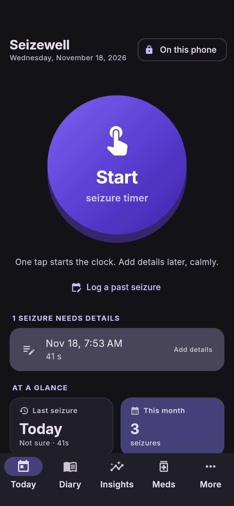<br><sub>Light and dark themes.</sub></td>
  </tr>
</table>

## The clinic report

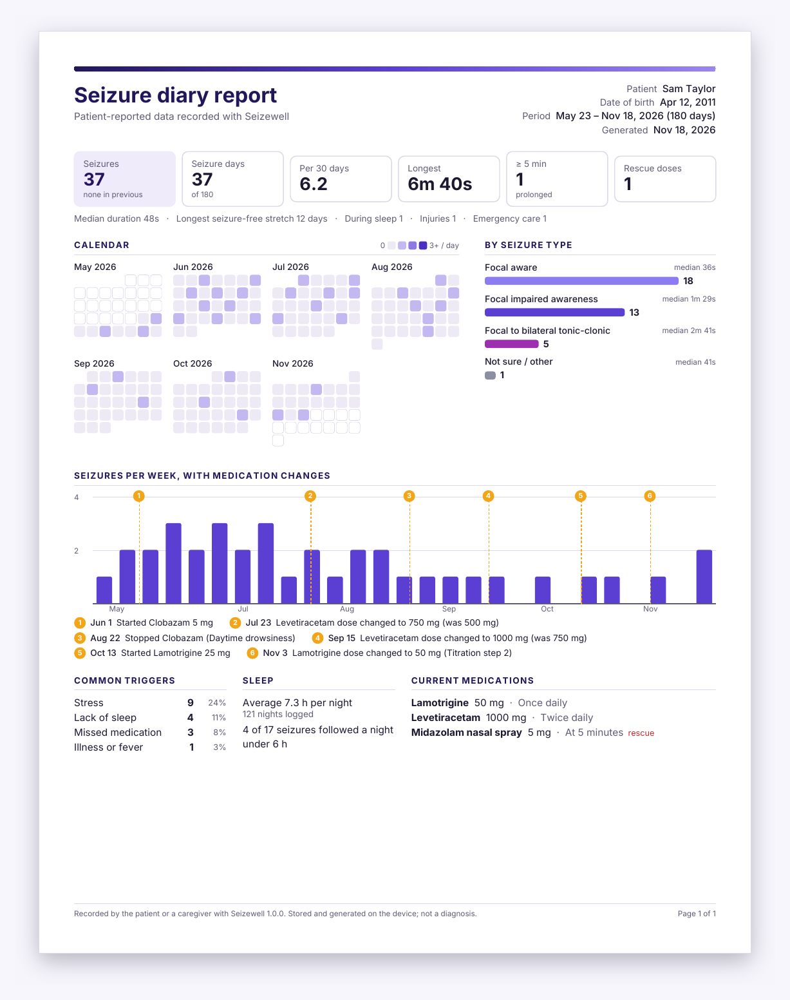

One page, built on the phone, for the neurologist:

- **Summary:** total seizures (and change vs. the previous period), seizure
  days, rate per 30 days, longest, prolonged, rescue doses, median duration,
  longest seizure-free stretch, injuries and emergency care.
- **Calendar heat map** of every day in the period.
- **Counts by seizure type** with median durations.
- **Timeline** of seizures per day or week with **numbered medication
  changes** (started, dose changed, stopped).
- **Triggers, sleep** (including how many seizures followed a short night)
  and **current medications**.

Choose 30 days to a year, US Letter or A4, then share or print
([sample report, fictional data](docs/sample-report.pdf)). Data can also
be exported as **CSV** (seizures, medication changes, sleep) or as a
**FHIR R4 Bundle** — seizures as SNOMED CT 91175000 Observations, sleep as
LOINC 93832-4 Observations, plus MedicationStatements. See
[docs/fhir.md](docs/fhir.md).

<br clear="right">

## Privacy and security

- **No account, no server, no cloud, no analytics.** The Android app does not
  request the `INTERNET` permission; CI fails the build if it ever does.
- **Encrypted at rest:** the diary is a [SQLCipher](https://www.zetetic.net/sqlcipher/)
  database (AES-256). Its random 256-bit key is generated on the phone and
  kept in the Android Keystore / iOS Keychain (`ThisDeviceOnly`).
- **Not in backups:** Android cloud backup and device-to-device transfer are
  disabled for app data.
- **Encrypted backups you control:** move to a new phone with a backup file
  encrypted from your own passphrase.
- **Optional app lock** (fingerprint, face or device PIN) that re-locks after
  a minute in the background — and never blocks the Start button.
- **Nothing on the home screen:** the widget and notifications show no
  health history.

Details: [PRIVACY.md](PRIVACY.md) · [SECURITY.md](SECURITY.md) (threat model
and private vulnerability reporting).

## Install

**Android** — download the APK from the
[latest release](https://github.com/lobojoel2003/Seizewell/releases/latest):

| File | Use it for |
| --- | --- |
| `Seizewell-<version>-arm64-v8a.apk` | Almost every Android phone from the last ~8 years |
| `Seizewell-<version>-armeabi-v7a.apk` | Older 32-bit phones |
| `Seizewell-<version>-universal.apk` | Not sure? This one works everywhere (bigger) |

Requires Android 7.0 or newer. Check the download against `SHA256SUMS.txt`.
After installing, add the **Seizure timer** widget or Quick Settings tile
for one-tap access.

**iOS** — each release includes an unsigned `.ipa` for sideloading (re-sign
it with your own Apple developer account or AltStore), or build from source
with Xcode. Requires iOS 15 or newer.

## Build from source

Requirements: [Flutter 3.50](https://docs.flutter.dev/get-started/install)
(stable), plus Android Studio / the Android SDK, or Xcode on a Mac.

```bash
git clone https://github.com/lobojoel2003/Seizewell.git
cd Seizewell
flutter pub get
flutter run                 # on a connected device or emulator
```

Release builds:

```bash
flutter build apk --release --split-per-abi   # Android APKs
flutter build appbundle --release             # Google Play
flutter build ios --release                   # iOS (needs signing in Xcode)
```

The first build downloads a prebuilt SQLCipher library for the target
platform (verified by SHA-256 hash in `package:sqlite3`).

## How it works

| Layer | Technology |
| --- | --- |
| UI | Flutter 3.50, Material 3 (`material_ui`), Inter font, `fl_chart` |
| Storage | [drift](https://drift.simonbinder.eu/) over SQLCipher (via `package:sqlite3` build hooks), key in `flutter_secure_storage` |
| Reports & exports | `pdf` + `printing`, CSV, FHIR R4 JSON |
| Alerts | `flutter_local_notifications` (chronometer notification, exact alarms) |
| Launch points | Kotlin `AppWidgetProvider` + `TileService` + method channel; `quick_actions` |
| Security | `local_auth`, Android manifest hardening, encrypted backups via `sqlcipher_export` |

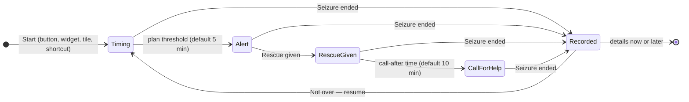

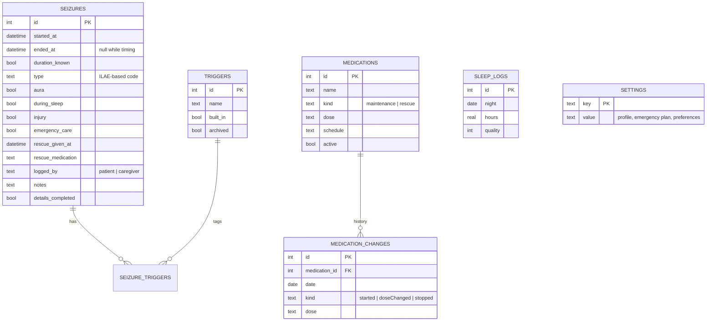

Project layout:

```
lib/
  main.dart              bootstrap: open the encrypted database, create services
  src/app.dart           root widget, lock gate, widget/tile/shortcut launches
  src/data/              drift schema, queries, settings store, sample data
  src/domain/            seizure types, emergency plan, statistics
  src/services/          alerts, backups, clinic PDF, CSV/FHIR, platform bridges
  src/ui/                screens and widgets
android/app/src/main/    manifest, widget, Quick Settings tile, launch channel
test/                    database, domain, export, report and widget tests
screenshots/             generates the images in this README
```

## Testing, CI/CD and releases

- **Tests** cover the encrypted database (wrong key, key loss, file is not
  readable without the key), queries, encrypted backup and restore, statistics,
  CSV and FHIR exports, the PDF report (always one page), and the main flows
  as widget tests: onboarding, one-tap timer → alert → rescue → end →
  details, app lock, launches from the widget/tile/lock screen.
- **[CI](.github/workflows/ci.yml)** on every push and pull request: formatting,
  generated code up to date, `flutter analyze --fatal-infos`, tests with
  coverage, an Android release build with a **check that the APK has no
  network permission**, and an iOS build.
- **[Releases](.github/workflows/release.yml)** are built from version tags:
  the tag must match `pubspec.yaml`, the full test suite runs, then per-ABI
  APKs, a universal APK, an Android App Bundle and an unsigned IPA are
  published with SHA-256 checksums and the notes from
  [CHANGELOG.md](CHANGELOG.md).
- **Versioning:** [SemVer](https://semver.org/) version names plus an
  always-increasing build number (`version: 1.0.0+1`), bumped with
  `scripts/bump_version.sh`. See [docs/RELEASING.md](docs/RELEASING.md),
  including how to set up the Android release key.

```bash
flutter analyze --fatal-infos
flutter test
flutter test screenshots/generate_test.dart   # regenerate README images
```

## Roadmap

- [ ] Optional **end-to-end encrypted sync** between a patient's and a
      caregiver's phones (no server can read it)
- [ ] iOS Lock Screen widget and Control Center control for the timer
- [ ] Wear OS / Apple Watch start button
- [ ] Medication reminders and missed-dose tracking
- [ ] Translations
- [ ] F-Droid listing (store metadata is already in `fastlane/`)

## Contributing

Issues and pull requests are welcome — please read
[CONTRIBUTING.md](CONTRIBUTING.md). Never include real health information in
issues or screenshots; the screenshots here use fictional sample data.

## License

Seizewell is free software: you can redistribute it and/or modify it under
the terms of the [GNU General Public License v3.0](LICENSE).
The Inter typeface is licensed under the
[SIL Open Font License 1.1](assets/fonts/OFL.txt).
